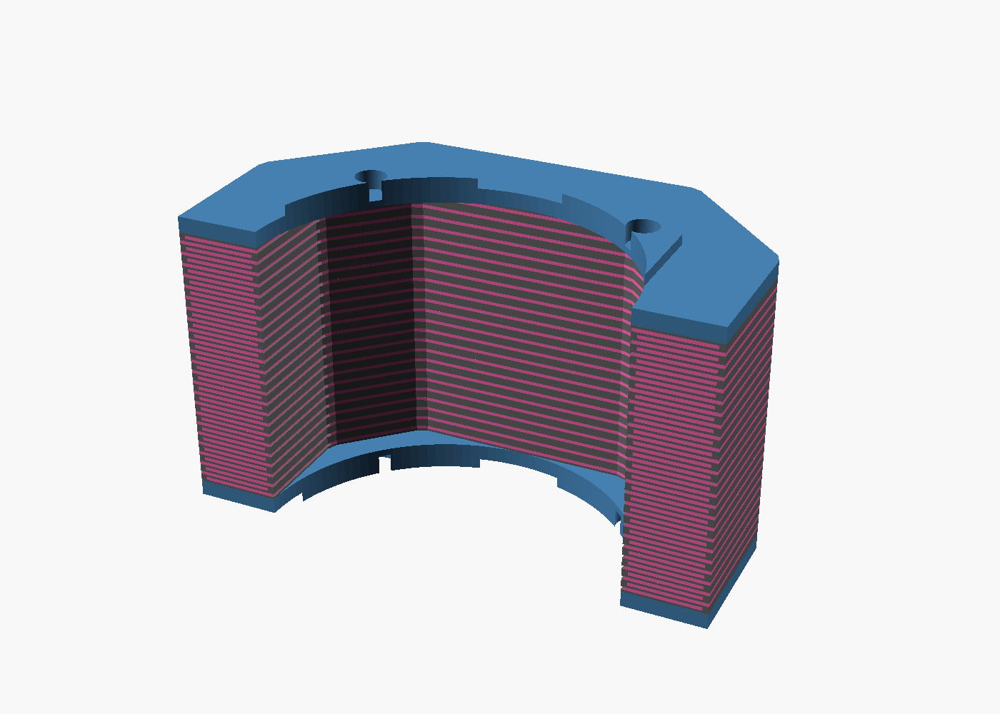

# Printed cage bellows

*Part of [OptSys](../../README.md).*

A light-tight bellows between two OptSys cage plates, printed in one go on a multi-material printer (toolchanger or filament changer) and fitted with frames that drop into the magnetic bellows recess of the plates. Status: **design, not printed yet**. Start with the test coupon.

## How it works

The bellows is printed **compressed**: a stack of flat TPU sheets, each joined to the next one alternately at the outer and at the inner edge. The gaps between the sheets are filled with sacrificial **PLA spacers**, which do not bond to TPU. After printing the spacers are pulled out and the stack opens like an accordion. The same technique is used for printed machine way covers.

| Body | Material | `part` |
|---|---|---|
| Bellows (sheets + joints, or TPU end flanges) | TPU (95A tested by others; not yet here) | `tpu` |
| Spacers | PLA | `spacers` |
| End frames with magnet pockets | PETG (TPU bonds to it) | `frames` |

Export the three STLs, load them in the slicer as **parts of one object** and assign one extruder each. Then make the slicer layers match the design: `layer_h` and `first_layer_h` must equal the slicer layer height and first layer height (default 0.15 / 0.2 mm). Sheets, gaps and frame tiers are whole layers, so each layer is one material where it should be.

## Geometry

- **Outline:** an octagon (square with large 45° chamfers) whose chamfer faces clear the cage rods by `rod_margin`. The chamfer is computed from the rods. The octagon also spreads the strain of stretching over eight corners instead of four.
- **Bore:** `clear_d` across the flats, also the round bore of the frames. Defaults: 48 mm on the 60 mm cage (passes the user's widest lens, Ø47.5, and a QM42 flange, Ø46), 62 mm on OptSys 100 (Ø60 lens). Because it passes the QM42 flange, the same bellows fits either face of a plate.
- **Sheets:** `sheet_layers` × `layer_h` thick (0.3 mm), gaps `gap_layers` × `layer_h` (0.45 mm), joints `joint_w` wide (0.8 mm = 2 lines). The number of sheets fills `length_min` (distance between plate faces as printed), or set `sheets_set`.
- **Frames:** a lower tier with the recess outline (minus `frame_clearance`) that stops `recess_gap` short of the recess floor, so the frame rests flat on the plate face. On top, an upper tier with the bellows outline, `frame_top_h` high. On a face with a QM42 receptor the flange fills the middle of the recess, so the lower tier is only four corner pads, which carry the magnets. Magnet pockets open on the mating face: press the magnets in after printing, with polarity matching the plate.
- **Ends:** each end is a PETG frame or a TPU flange (`end_bottom`, `end_top`). The flange is for gluing onto another frame, such as the paper-bellows frames.

Interface values (recess outline, depth, magnet size and position) come from `OPTSYS_BELLOWS_RECESS` in `lib/standards.scad`, the same table the cage plate uses.

## Length

The console line gives the number of sheets, the compressed length and an **estimate** of the extended length: each gap is assumed to open to `stretch` × sheet width (0.3 by default). A closed TPU bellows can only extend by bending and stretching its sheets (unlike paper bellows, whose corner folds do not stretch), so it pulls the plates back toward its printed, compressed state. Calibrate `stretch` and judge that force with the test coupon.

| Preset | Sheets | Compressed | Extended (est.) | Spacer pieces |
|---|---|---|---|---|
| `60 mm, 40-150 mm between plates, PETG frames` | 48 | 39.8 mm | ~174 mm | 284 |
| `60 mm test coupon: 10 sheets, frame + TPU flange` | 10 | 10.1 mm | ~36 mm | 56 |
| `100 mm, 40-150 mm between plates, PETG frames` | 47 | 39.9 mm | ~254 mm | 276 |

## Removing the spacers

Each spacer is cut into pieces by `cut_w` slots, so that every piece slides out of its pocket flat. Stretch the bellows a little first, to break the weak TPU-PLA contact and open the pockets.

- **Pockets open to the outside** (joint at the bore): 4 pieces. Pull the ±x pieces out sideways, then the ±y pieces.
- **Pockets open into the bore** (joint outside): 8 pieces with `corner_cuts`. Slide the ±y pieces into the bore, then the ±x pieces, then the 4 corners diagonally, and take them out through the bore. Without `corner_cuts` there are 4 pieces, and the two long ones must bow to come out.

## Test coupon first

Before a full bellows, print the coupon preset (10 sheets, one PETG frame, one TPU flange) and check:

1. Does the PLA separate cleanly from the TPU, and does the TPU stay bonded to the PETG?
2. How far does each gap open without forcing it? Set `stretch` from that.
3. How hard does it pull back when extended, compared with the magnets?
4. Is it light-tight? Shine a flashlight inside, in a dark room.
5. Frame or flange end: which one works better?

Variables worth trying: TPU sheet thickness (`sheet_layers` 2 or 3), spacer thickness (`gap_layers`), and the slicer infill pattern of the sheets (concentric vs lines).
