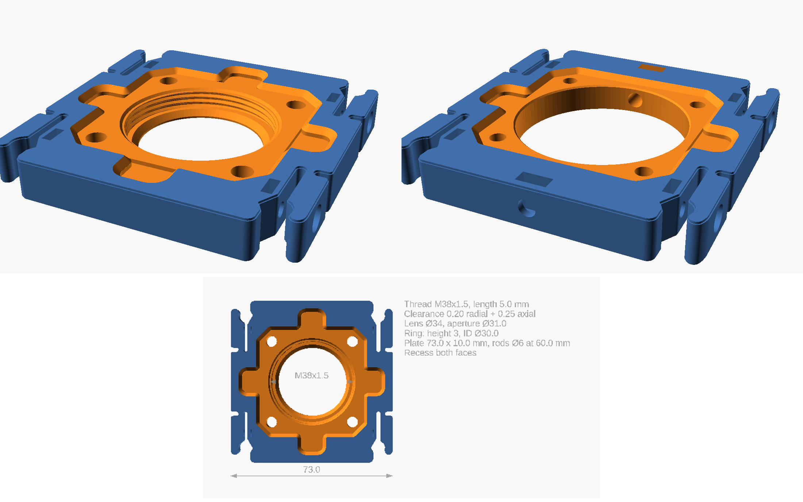

# Lens cage plate

*Part of [OptSys](../../README.md).*

An OpenSCAD lens mount plate for a rod-based optical cage system. Each plate holds a lens with a threaded retaining ring (or works as a receptor for [QM quick-mount lens adapters](../quick_mount/README.md)), can carry a magnetic bellows on either face, and clamps onto four steel rods with compliant clamps. The hinges can optionally be printed in TPU (multi-material).

*Left: 100 mm standard, single material, with a post mount on the bottom side. Right: 60 mm standard with TPU hinges and rod seat liners (orange) and ghost rods (grey). Both rendered at the same scale.*

## Features

- **Three standards** from one file:
  - **100 mm**: 100 × 100 mm plate, Ø8 rods at 85 mm spacing, Ø60 lens (M64×1.5 thread).
  - **60 mm**: 73 × 73 mm plate, Ø6 rods at 60 mm spacing (same rod size and spacing as the Thorlabs 60 mm cage system), Ø38.1 (1.5") lens (M43×1.5 thread). Without the bellows recess it takes a Ø50.8 (2") lens.
  - **50 mm**: 63 × 63 mm plate, Ø6 rods at 50 mm spacing (the user's epi-illuminator cage), Ø25.4 (1") lens (M30×1.5 thread), or a QM42-EPI receptor.
- **Lens mount** (`lens_mount`): `thread` (lens + retaining ring) or `qm`, a receptor for QM quick-mount adapters: Ø42 bore, M4 lock screw (heat-set insert or captive nut) on the side you choose, optional dowel-pin centering. The seat face is placed so the lock screw is centered in the plate thickness: with `QM42` (Ø46 flange) on a 10 mm plate it is the front recess floor (1.5 mm) of the 60 and 100 mm plates, or a Ø46.6 × 1.5 flange pocket when the front face has no recess.
- **V rod seats**: the clamp arm pushes the rod into a V on the body side, so it touches two lines along the whole thickness and the plate cannot tilt on the rod. `rod_v_angle` (default 120°) trades centering stiffness for snap-in effort; the console prints the snap interference. (The earlier round seat with clearance was dropped: the rod touched it on a single line and the plate could rock around it.)
- **Thread clearances**: `thread_clearance` (diametral, 0.2) plus `thread_z_clearance` (axial, 0.25), both split between plate and ring: about 0.48 mm of axial play while keeping the full radial engagement. Printed flat, the 60° thread flanks are only 30° from the bed, so layer steps and sag land on them: radial clearance alone opens the flanks by half its value and loosens the thread. The ring has 45° chamfers on both ends (`ring_chamfer`) against the elephant foot.
- **Lens-driven geometry**: set the lens diameter and the aperture, seat cone, internal thread and retaining ring follow automatically.
- **Magnetic bellows recess** on the front, back, both or neither face: 45° walls for self-centering, pry notches for removal, and magnet pockets.
- **Compliant rod clamps**: slotted arm with a flexure hinge, locked with an M3 screw into a captive nut.
- **Multi-material option**: hinges (optionally plus a rod-seat liner, or the whole arm) printed in TPU95A, anchored to the rigid part with dovetails.
- **Post mount**: optional captive M4 nut in the middle of any side, to fix the plate on a post with an M4 setscrew stud.
- **Retaining ring** generated to match the thread.
- **Interference checks**: when a parameter change makes features collide, OpenSCAD stops with a message saying what to adjust.

## Usage

1. Open `lens_cage_plate.scad` from this folder. It loads the shared library from `../../lib`, so keep the repository structure intact; `lens_cage_plate.json` must stay next to it.
2. In the Customizer, pick a preset from the drop-down at the top:
   - `100 mm standard (Ø8 rods at 85 mm)`
   - `60 mm standard (Ø6 rods at 60 mm)`
   - `60 mm standard, no recess (2 in lens)`
   - `50 mm standard (Ø6 rods at 50 mm, 1 in lens)`
   - `50 mm QM42-EPI receptor, V rod seats (EPI style, no recess)`
   - `60 mm QM42 receptor, V rod seats`
   - `100 mm QM42 receptor, V rod seats`
3. Adjust any parameter. Fields marked **"0 = from standard"** take the preset value; any number you enter overrides it.
4. Check the console: it reports the resulting thread, plate size, recommended screw lengths and any interference errors.

### Parts (`part`)

| Value | Output |
|---|---|
| `assembly` | Preview of rigid + TPU parts with ghost rods |
| `rigid` | Rigid part (PLA/PETG) |
| `tpu` | Flexible part (TPU95A) |
| `single` | Whole plate in a single material |
| `ring` | Retaining ring |

### Multi-material printing

1. Export `part = "rigid"` and `part = "tpu"` as separate STLs (binary STL is recommended).
2. Load both in the slicer **as one object with two parts**. They share the same origin, so they line up automatically.
3. Assign PLA/PETG to the rigid part and TPU95A to the flexible part.

`tpu_mode` options:

| Mode | TPU zones | Notes |
|---|---|---|
| `none` | – | Single material, 2 mm rigid hinge |
| `hinge` | Hinges | Recommended. The clamped load path goes through the screw, not the hinge, so alignment stays rigid |
| `hinge_liner` | Hinges + rod seat liner | Liner on the arm side only, with slight preload; the rigid body side stays the reference |
| `arm` | Whole arm | Not recommended for optics: the screw head clamps on TPU, which creeps |

In `hinge` mode the rigid arms are separate islands in the rigid STL, held only by the TPU. That is expected.

### Hardware

- Clamp screws: 4 × M3 screw + M3 nut (length printed in the console, M3 × 10 or 12).
- Post mount: 1 × M4 nut + M4 setscrew stud (length printed in the console).
- Magnets: Ø6 (100 mm standard) or Ø5 (60 mm standard), when the recess is enabled.

## Files

| File | Content |
|---|---|
| `lens_cage_plate.scad` | Parametric model |
| `lens_cage_plate.json` | Customizer presets for each standard |
