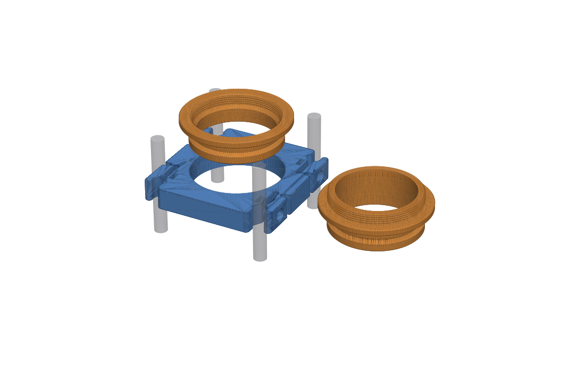

# QM quick-mount lens adapters

*Part of [OptSys](../../README.md).*

One small adapter per lens, one receptor per cage position. The adapter carries the lens (enlarger lens, microscope objective) or screws into a bellows / helicoid, and drops into a **QM receptor**: a cage plate with `lens_mount = "qm"` ([`parts/cage_plates`](../cage_plates/README.md)). Print the adapters small and fine (0.08 mm layers work well for the L39 thread).

## How the QM interface works

Taken from the user's tested quick mount (epi-illuminator cage, Pentax bellows):

- The adapter has a **Ø42 spigot** and a **Ø46 × 3 flange** (Ø50 on QM42-EPI). The spigot goes into a Ø42 bore in the receptor; the flange underside rests on the receptor seat face.
- Around the spigot runs a **groove** with a flat step on top and a **conical flank** below.
- A radial **M4 lock screw** in the receptor (captive nut) presses on the conical flank. Part of its force pulls the flange onto the seat face (about 1.4 × the screw force with the 55° flank): the seat face sets the axial position and the tilt. The rest pushes the spigot against the opposite bore wall: that sets the centering.
- The groove runs all around, so the lens can be clocked freely (aperture scale where you want it).

All dimensions live in `OPTSYS_QUICKMOUNTS` (`lib/standards.scad`); the geometry in `lib/quickmount.scad` (`qm_spigot_flange`, `qm_receptor_cut`).

Two interfaces with the same groove profile, **not interchangeable**:

| | `QM42` (OptSys) | `QM42-EPI` (tested EPI plates) |
|---|---|---|
| Receptor | 10 mm plate with 1.5 mm bellows recesses on both faces: flange on the front recess floor, spigot fills the 7 mm web | 10 mm plate without recesses |
| Spigot | Ø42 × 7 mm | Ø42 × 10 mm |
| Flange | Ø46 × 3 mm (fits on the 47 mm recess floor of the 60 mm plate, inside its magnets) | Ø50 × 3 mm |
| Lock screw | M4, 3.5 mm below the seat face (plate center) | M4, 5 mm below the seat face (plate center) |
| Groove | flat step 1.9 mm below the seat, bottom Ø38.6, conical flank from 3.7 to 4.9 mm | step 3.4, flank from 5.2 to 6.4 mm |

## Adapter (`qm_adapter.scad`)

| Preset | Mode | Thread | Use |
|---|---|---|---|
| `L39 enlarger lens (QM42)` | female | 39 mm × 26 TPI | El-Nikkor, Componon, Rodagon ... (sold as "M39") |
| `RMS objective (QM42)` | female | 0.8" × 36 TPI | Most finite microscope objectives |
| `M25 x 0.75 objective (QM42)` | female | M25 × 0.75 | Leica / Nikon objectives |
| `M42 x 1 male - Pentax bellows / helicoid (QM42)` | male | M42 × 1 | Screws into an M42 bellows, helicoid or extension tube |
| `T2 male - M42 x 0.75 (QM42)` | male | M42 × 0.75 | T2 accessories |

Parameters:

- `thread_clearance`: diametral clearance of the lens thread. Default 0.15 mm, which reproduces the tested M39 adapter. Keep it small: at 0.6 the L39 thread engages only 0.23 of its 0.53 mm depth, and the lens can start one turn ahead on one side and seat tilted (one pitch across Ø39 ≈ 1.4°).
- `thread_z_clearance`: axial play between the flanks (default 0.2 mm), without loosening the radial engagement. Printed flat, the flanks are only 30° from the bed (layer steps, sag): if the lens is hard to screw in, raise this one. Calibrate both with the [thread test rings](../test_coupons/README.md).
- `hub_wall = 0`: no hub; the lens rests on the flange top (the thread is shortened to fit in the spigot + flange: 4.1 mm for L39).
- `hub_h`: raises the lens register above the receptor seat face (e.g. to set an objective's parfocal distance). The console prints where the lens flange / objective shoulder sits.
- `bore_d_set`: clear bore under the thread (automatic = as large as the spigot walls allow, Ø35.4 for QM42).
- `orientation`: `spigot_down` (as the tested adapter) or `lens_down` (lens face on the bed: the flange underside, which is the seat reference, prints as a top surface).

## Receptor

Use `parts/cage_plates/lens_cage_plate.scad` with one of the QM presets:

- `50 mm QM42 receptor, V rod seats` (uses `QM42-EPI`, for the EPI plates and adapters; set `qm = QM42` for OptSys adapters: the flange then sits in a Ø46.6 × 1.5 pocket)
- `60 mm QM42 receptor, V rod seats` (flange seats on the front recess floor; the bellows frame must clear the Ø46 flange)
- `100 mm QM42 receptor, V rod seats` (flange seats on the front recess floor)

Receptor options (section *Lens mount*): `qm_bore_clearance` (diametral clearance of the Ø42 bore, default 0.3; the tested EPI plate had 0.04 in PLA), `qm_screw_side`, `qm_screw_hole_d` (lock screw hole, default 4.5 = M4 clearance), `qm_nut_depth` (captive M4 nut 5 mm from the edge, slot open on the front face, like the post mount). The bore diameter is engraved on the plate (`label`). The console prints the lock screw length (M4 setscrew).

## Hardware

- Receptor: one M4 nut and one M4 setscrew (length printed in the console: M4 × 14 on the 50 mm plate, M4 × 20 on the 60 mm).
- Adapter: none.
