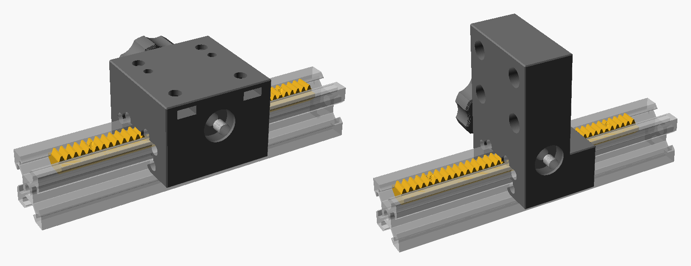

# Rail carriage (2020 V-slot, rack and pinion)

*Part of [OptSys](../../README.md).*

A carriage that slides on a 2020 V-slot extrusion on six Ø4 PTFE tubes and is driven by a knob through a pinion and a rack locked in the top slot of the profile. One file generates the carriage, the pinion, the knob and the rack, so the gear mesh always matches. Stack an XY carriage and a cross rail for XY adjustment; the end of a vertical 2020 can be tapped M4 and used as a post for OptSys plates.

*Left: XY carriage (top mount). Right: Z carriage (side tower). Ghost profile and PTFE tubes in grey, pinion and rack in yellow.*

## Features

- **Six PTFE tube bearings**, Ø4 tubes pressed into seats along the carriage: two rest on the top face, two on the side faces near the top corners, and two in the V of the side slots. The tubes in the V hold the carriage down and sideways; a lip under them reaches into the side slot as a backup.
- **Rack and pinion**: module 0.8, 16-tooth pinion (40.2 mm of travel per knob turn), shaft in two 604ZZ bearings. Gears are true involute profiles from `lib/gears.scad`.
- **Rack** that slides into the top slot of the profile from its end and is locked by M3 set screws pushing it up against the slot lips. Its length is rounded to a whole number of teeth, so several racks can be placed end to end.
- **Two mounts**:
  - `top` (XY): four M4 nuts under the top face on a 25 mm square, to stack another stage or fix a part, plus two Ø3.3 tap holes on the +Y half for self-tapping M4 screws.
  - `side` (Z): a tower with four counterbored M4 holes on a 25 × 18 mm grid.
- **Stacking**: the Z tower bolts onto the top of an XY carriage. Its 25 × 18 grid matches the two -Y nut holes plus the two tap holes of the XY carriage (2 screws into nuts, 2 self-tapping).
- **Drive height** (`drive_offset`): moves the shaft, bearings and pinion up or down; the rack teeth follow so the mesh is kept, and a slot for the rack opens through the carriage when the teeth reach the channel ceiling. At 0 the shaft hole just touches the top tube seats (as in the original design); the console reports the offset that leaves a wall between them (0.85 mm with the defaults). A carriage, its pinion and its racks must be generated with the same `drive_offset`.
- **Pinion pocket**: `gable` (default) has 45° sides from the channel to a flat top, so the carriage prints standing on an end face without overhangs; `compact` keeps more material around the pinion for printing on the bottom face.
- **Interference checks**: when a parameter change makes features collide, OpenSCAD stops with a message saying what to adjust.

## Usage

1. Open `rail_carriage.scad` from this folder. It loads the shared library from `../../lib`, so keep the repository structure intact; `rail_carriage.json` must stay next to it.
2. Pick a preset from the drop-down at the top of the Customizer:
   - `XY carriage (top mount, stackable)`
   - `Z carriage (side tower)`
3. Choose what to export with `part`, adjust parameters and check the console: it reports the travel per turn, the tube positions, the rack length and the hardware.

### Parts (`part`)

| Value | Output | Print orientation |
|---|---|---|
| `assembly` | Preview with ghost profile, tubes, bearings, shaft and knob | – |
| `carriage` | Carriage | Standing on an end face (rail axis vertical): tube seats and channel print without overhangs. Z carriage: on the back face of the tower |
| `pinion` | Pinion | Flat |
| `knob` | Knob | Nut pocket on the bed |
| `rack` | Rack (length `rack_len`) | Teeth up |

## Coordinates

The rail (extrusion) axis is X, the carriage is centered on x = 0 with its bottom face on z = 0 (print orientation), and the profile axis is at y = 0, z = `skirt`. Tube positions are given relative to the profile axis.

## Hardware

| Item | Quantity |
|---|---|
| PTFE tube, Ø4 outside, cut to the carriage length (40 mm XY, 30 mm Z) | 6 |
| 604ZZ bearing (4 × 12 × 4) | 2 |
| M4 threaded rod (shaft) + M4 nut in the knob | 1 + 1 |
| M4 nuts, top mount | 4 |
| M4 socket head screws, side tower (length printed in the console): 2 into the XY nuts, 2 self-tapping into the tap holes | 4 |
| M3 set screws per rack | 3 |

The pinion has a D bore by default (`pinion_d_bore` 4.1, `pinion_d_flat` 3.6 across the flat) so it cannot slip on a shaft with a flat. Other options: `tap` (3.3 mm tap drill to thread it onto an M4 rod), `hex` (clearance hole and captive M4 nut) and `solid`.

## Files

| File | Content |
|---|---|
| `rail_carriage.scad` | Parametric model (carriage, pinion, knob, rack) |
| `rail_carriage.json` | Customizer presets (XY and Z carriages) |
