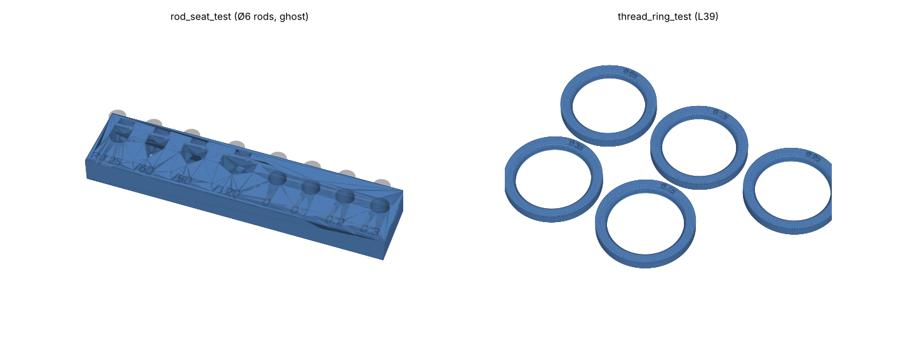

# Test coupons

*Part of [OptSys](../../README.md).*

Small, quick prints to measure how your printer, filament and hardware fit before committing the values to real parts.

## Rod seat test (`rod_seat_test.scad`)

A bar with one rod seat per cell, to choose how cage plates sit on their rods.

| Cell | Label | What it tests |
|---|---|---|
| Round seat + screw | `R0.25` | The current plate seat: round, 0.25 mm diametral clearance, rod pushed against it (reference) |
| V seats + screw | `V60`, `V90`, `V120` | Rod pushed into a V: two contact lines along the whole thickness, no play |
| Closed holes | `0`, `0.1`, `0.2`, `0.3` | Tight holes with that diametral clearance |

Why a V: a rod pushed against a round seat with clearance touches it along a single line, so the plate can still rock around that line. In a V it touches two lines along the full plate thickness and the push leaves no play, so the plate stays perpendicular to the rod without needing a tight hole, and it can still be opened on one side to go onto an assembled cage. If the printed V comes out a bit large or small, the rod only moves along the V bisector.

**Hardware:** one M3 × 8 screw and one M3 nut per screw cell (4). The nut drops into its slot from the top face.

**Print:** flat, as exported (rods vertical, like the plates), same material, layer height and settings you use for the plates. Thickness `block_t` defaults to 10 mm, the plate thickness.

**Test:**
1. Hold a rod vertically (in a vise, or in a plate).
2. Slide the bar onto it, one cell at a time. For screw cells, snug the screw.
3. Rock the bar by hand and look for play; check squareness against the rod with a small square, or slide two bars along the rod and compare.
4. Report which V angle (and which hole clearance, for comparison) holds best. That angle becomes the default for parts that use `lib/rod_seats.scad`, such as the plates.

Presets: `Ø6 rods (30 / 50 / 60 mm cages)`, `Ø8 rods (OptSys 100)`. Other rods: set `rod_d_set`. The cell lists (`v_angles`, `hole_clearances`, `round_clearance`) can be edited.

## Thread test rings (`thread_ring_test.scad`)

A set of short rings (5 mm, about 5 turns for L39) with the same internal thread and increasing diametral clearance, engraved on the top face. Screw the real lens into each and keep the clearance that turns smoothly without play.

| Preset | Thread | For |
|---|---|---|
| `L39 - enlarger lenses (39 mm x 26 TPI)` | Ø39 × 0.977 | Enlarger lenses (El-Nikkor, Componon, ...), sold as "M39" |
| `RMS - microscope objectives` | Ø20.32 × 0.706 (36 TPI) | Most finite objectives |
| `M25 x 0.75 - Leica / Nikon objectives` | Ø25 × 0.75 | Leica / Nikon objectives |

Also available in `thread`: `M39x1`, `M42x1`, `T2` (M42 × 0.75), `M27x0.75` (Zeiss), `M26x36TPI` (Mitutoyo). Default clearances: 0.05, 0.15, 0.25, 0.35, 0.45 mm. With L39, the 0.15 ring has about the same profile as the user's tested M39 quick-mount adapter (major Ø39.16, minor Ø38.0).

Threads use the OptSys 60° profile (`lib/threads.scad`); lens threads are 55° Whitworth, which the clearance absorbs. Both ends have a 45° entry chamfer.

**Print:** flat, fine layers (0.08 mm works well for L39); RMS (0.706 mm pitch) is at the limit of FDM, so this test also tells whether printed objective threads are usable or a metal adapter is needed. `which` outputs a single ring (1 = first clearance); `0` outputs all of them in a grid.
