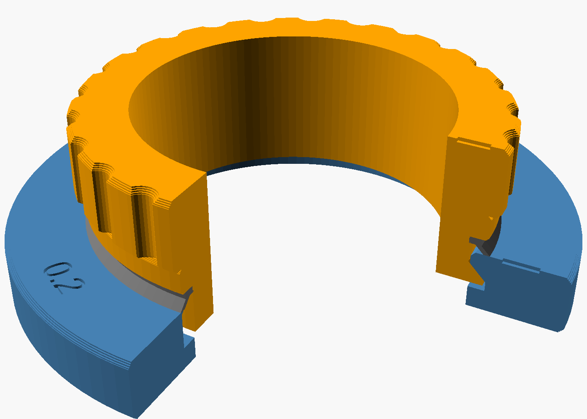

# Test coupons

*Part of [OptSys](../../README.md).*

Small, quick prints to measure how your printer, filament and hardware fit before committing the values to real parts.

## Rod seat test (`rod_seat_test.scad`)

A bar with one rod seat per cell, to choose how cage plates sit on their rods.

| Cell | Label | What it tests |
|---|---|---|
| Round seat + screw | `R0.25` | The current plate seat: round, 0.25 mm diametral clearance, rod pushed against it (reference) |
| V seats + screw | `V60`, `V90`, `V120` | Rod pushed into a V: two contact lines along the whole thickness, no play |
| Closed holes | `0`, `0.1`, `0.2`, `0.3` | Tight holes with that diametral clearance |

Why a V: a rod pushed against a round seat with clearance touches it along a single line, so the plate can still rock around that line. In a V it touches two lines along the full plate thickness and the push leaves no play, so the plate stays perpendicular to the rod without needing a tight hole, and it can still be opened on one side to go onto an assembled cage. If the printed V comes out a bit large or small, the rod only moves along the V bisector.

**Hardware:** one M3 × 8 screw and one M3 nut per screw cell (4). The nut drops into its slot from the top face.

**Print:** flat, as exported (rods vertical, like the plates), same material, layer height and settings you use for the plates. Thickness `block_t` defaults to 10 mm, the plate thickness.

**Test:**
1. Hold a rod vertically (in a vise, or in a plate).
2. Slide the bar onto it, one cell at a time. For screw cells, snug the screw.
3. Rock the bar by hand and look for play; check squareness against the rod with a small square, or slide two bars along the rod and compare.
4. Report which V angle (and which hole clearance, for comparison) holds best. That angle becomes the default for parts that use `lib/rod_seats.scad`, such as the plates.

Presets: `Ø6 rods (30 / 50 / 60 mm cages)`, `Ø8 rods (OptSys 100)`. Other rods: set `rod_d_set`. The cell lists (`v_angles`, `hole_clearances`, `round_clearance`) can be edited.

## Thread test rings (`thread_ring_test.scad`)

A set of short rings (5 mm, about 5 turns for L39) with the same internal thread and increasing diametral clearance, engraved on the top face. Screw the real lens into each and keep the clearance that turns smoothly without play.

| Preset | Thread | For |
|---|---|---|
| `L39 - enlarger lenses (39 mm x 26 TPI)` | Ø39 × 0.977 | Enlarger lenses (El-Nikkor, Componon, ...), sold as "M39" |
| `RMS - microscope objectives` | Ø20.32 × 0.706 (36 TPI) | Most finite objectives |
| `M25 x 0.75 - Leica / Nikon objectives` | Ø25 × 0.75 | Leica / Nikon objectives |

Also available in `thread`: `M39x1`, `M42x1`, `T2` (M42 × 0.75), `M27x0.75` (Zeiss), `M26x36TPI` (Mitutoyo). Default clearances: 0.05, 0.15, 0.25, 0.35, 0.45 mm, all with `z_clearance` = 0.2 mm of axial play (printed flat, FDM threads mostly need play along the flanks). With L39, the 0.15 ring has about the same profile as the user's tested M39 quick-mount adapter (major Ø39.16, minor Ø38.0).

Threads use the OptSys 60° profile (`lib/threads.scad`); lens threads are 55° Whitworth, which the clearance absorbs. Both ends have a 45° entry chamfer.

**Print:** flat, fine layers (0.08 mm works well for L39); RMS (0.706 mm pitch) is at the limit of FDM, so this test also tells whether printed objective threads are usable or a metal adapter is needed. `which` outputs a single ring (1 = first clearance); `0` outputs all of them in a grid.

## Bayonet quick mount test (`bayonet_test.scad`)

Experimental push-and-turn mount for the QM42 spigot (Ø42), to try before changing the plates and the adapters. Geometry in [`lib/bayonet.scad`](../../lib/bayonet.scad).

How it works: the adapter has 3 lugs at the end of its spigot. Push it into the receptor through the 3 notches, turn it 45° clockwise (seen from the front) under the ledge, and let go: a printed TPU spring ring between the flange and the seat face pushes the adapter forward and the lugs drop into a shallow pocket at the end of the turn (click). To release, push in and turn back, like a BNC connector.

- The lug and ledge faces are 45° cones: they print without supports and, pulled together by the spring, center the adapter. The 3 lugs set position and tilt; the flange does not touch the seat.
- The bore clearance (0.4, as tested with QM42) no longer sets the centering.
- Clocking: 3 positions (one per lug), not free like QM42.

| Part | Count | Variants | Print |
|---|---|---|---|
| Receptor disc | one per value of `detents` (default 0.2, 0.35, 0.5) | detent pocket depth, engraved on the seat face | PLA, seat face up, 0.08–0.12 mm layers |
| Adapter | 1 | lugs + flange + a fluted grip ring standing in for the lens (Ø48 × 8, about an El-Nikkor body; `grip_d`, `grip_h`) | PLA, grip down |
| Spring ring | one per value of `spring_t` (default 0.5, 0.7, 0.9) | lip thickness; 1, 2 or 3 small notches in the bore | TPU 95A, base ring down |

**Test:**
1. Slip a spring ring onto the spigot, against the flange (lip toward the lugs).
2. Push the adapter into a receptor (lugs in the notches), turn clockwise until it clicks, let go.
3. Check: is the click clear, does it turn back without pushing (it should not), play when locked (wiggle, rock), centering (repeat and compare against a mark), how hard the push and the turn are.
4. Try every spring with every receptor; cycle the best pair many times and look for wear or a weaker click.
5. Report the detent depth and lip thickness you like. Too stiff: thinner lip or lower `preload`. Too soft or loose: thicker lip.

Rough force estimate (TPU 95A, E ≈ 25–50 MPa, very uncertain): lip 0.7 ≈ 10–30 N locked, about twice that pushed in to turn. Lip force goes with the cube of the thickness.

Sizes: lug tips Ø45.6 and groove Ø46.2 with the defaults (`lug_depth` 1.8). The same values are the `BQ42` interface of the plates and adapters (`lens_mount = bayonet`, `qm = BQ42`); it fits the 70 and 100 mm plates, and the 60 mm one only with Ø4 magnets and no front recess. The receptor is 7 mm thick, the web of a 10 mm plate with 1.5 mm recesses.
